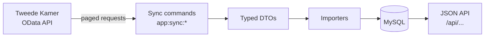

# PolitiConnect

[](https://github.com/VibeCommitCry/Social-Politics/actions/workflows/symfony.yml)
[](https://github.com/VibeCommitCry/Social-Politics/actions/workflows/code-quality.yml)
[](https://github.com/VibeCommitCry/Social-Politics/actions/workflows/code-format.yml)
[](https://github.com/VibeCommitCry/Social-Politics/actions/workflows/secret-scan.yml)

**Follow Dutch politics without reading parliamentary paperwork.**
PolitiConnect answers one simple question for ordinary citizens: *how did my party vote, and on what?* It turns the official records of the Tweede Kamer (the Dutch House of Representatives) into a clear overview of recent decisions and how each party voted on them.

**Under the hood.**
A Symfony 8 / PHP 8.4 backend that syncs the Tweede Kamer's open data (OData API) into MySQL through a typed, tested import pipeline, and serves it as a JSON API. It runs fully in Docker, and every push is checked by PHPUnit, PHPStan, PHP CS Fixer, a dependency audit, migration checks and a secret scan.

> The source data and the app's content are Dutch; the code and documentation are English.

## Status

- ✅ Sync of parties (fracties), cases (zaken), decisions (besluiten), agenda points, activities and votes (stemmingen) into MySQL
- ✅ Real vote dates on every decision
- ✅ Test suite (unit, integration and command tests) and CI
- ⬜ `GET /api/fractions`: list of parties
- ⬜ `GET /api/fractions/{id}/votes`: how one party voted
- ⬜ `GET /api/decisions/{id}`: one decision with its outcome and the vote per party
- ⬜ `GET /api/decisions/recent`: timeline of the latest votes

The detailed plan is in [ROADMAP.md](ROADMAP.md).

## Where it's heading

A mobile app with a scrolling feed of recent votes. Later versions add filters by topic, party profiles with voting history, and plain-language summaries of what was voted on.

## Tech & quality

| | |
|---|---|
| **Backend** | PHP 8.4, Symfony 8.1, Doctrine ORM 3 |
| **Database** | MySQL 8.0 with Doctrine migrations |
| **Runtime** | Docker Compose (php-fpm, nginx, MySQL) |
| **Tests** | PHPUnit 13: unit, repository integration and command tests on a fresh test database |
| **CI (GitHub Actions)** | tests, PHPStan, PHP CS Fixer, `composer audit`, migration and schema validation, gitleaks secret scan |

## How it works



Each data type follows the same pipeline:

1. A **sync command** builds a **filter** (endpoint, `$filter`, `$orderby`, page size).
2. The **API provider** fetches the pages lazily and turns each record into a typed, read-only **DTO**.
3. An **importer**, picked automatically for that DTO, saves it as a Doctrine **entity**.

`app:sync:all` runs the syncs in dependency order, because votes can only be saved once their party and decision exist: fractions → cases → decisions → agenda points → activities → votes.

The API uses Dutch names; the code uses English ones:

| Tweede Kamer (Dutch) | Entity |
|---|---|
| Fractie | `Fraction` (party) |
| Zaak | `GovermentCase` (case, e.g. a motion or bill) |
| Besluit | `Decision` |
| Stemming | `Vote` |
| Agendapunt | `AgendaPoint` |
| Activiteit | `Activity` |

## Run it locally

You need Docker. From the repo root:

```sh
docker compose up -d --build
```

This starts the backend (php-fpm), nginx on http://localhost:8080 and MySQL (on host port 3308). On startup the backend waits for the database and runs the migrations.

Fill the database with real data:

```sh
docker compose exec backend php bin/console app:sync:all
```

Each sync can also run on its own, for example:

```sh
docker compose exec backend php bin/console app:sync:decision --top=250 --max=500
docker compose exec backend php bin/console app:sync:vote
```

`--top` sets the page size and `--max` caps the number of records per run.

Run the tests. They need the root user, because the test database is dropped and recreated before every run:

```sh
docker compose exec -e DATABASE_URL="mysql://root:rootsecret@db:3306/politiconnect?serverVersion=8.0&charset=utf8mb4" backend php bin/phpunit
```

The passwords in `docker-compose.yml` are for local development only.

## License

© 2026 VibeCommitCry. All rights reserved. The code is public to read, but it may not be copied, changed or reused without permission.

The parliamentary data comes from the [Tweede Kamer open data portal](https://opendata.tweedekamer.nl/).
